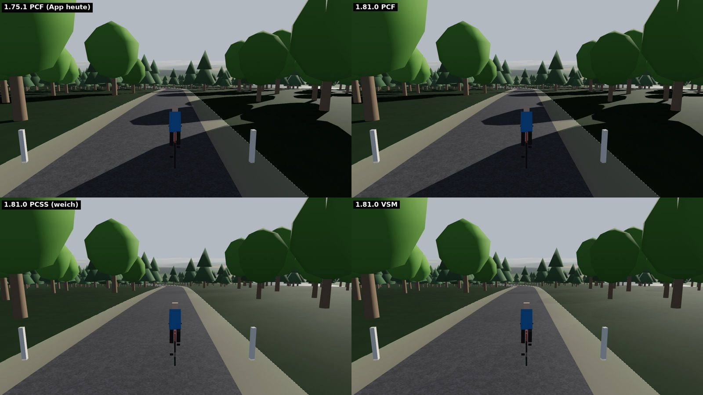
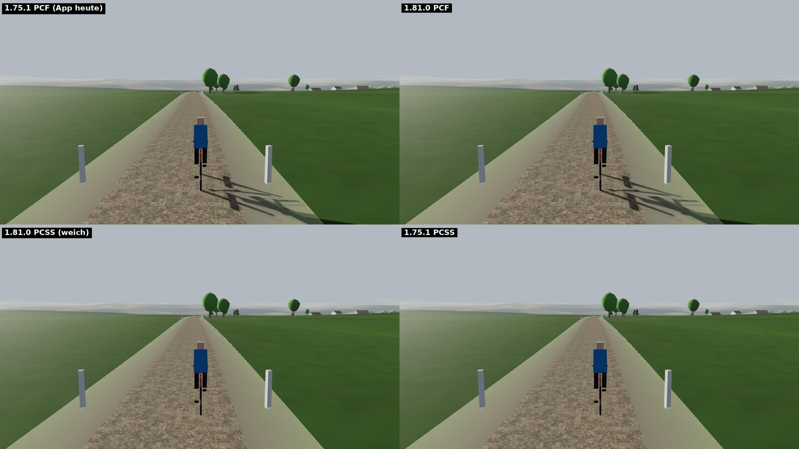
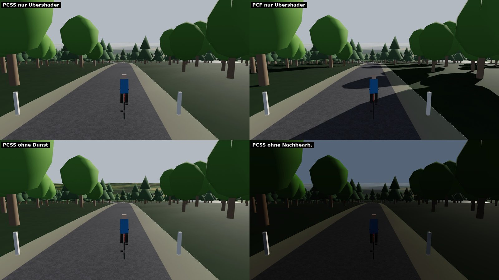
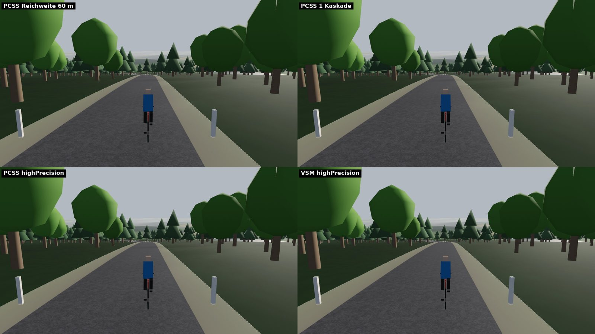

# Filament-Upgrade 1.75.1 → 1.81.0: Machbarkeit und Prototyp

Stand 25.11.2026, Branch `claude/grafik-filament-upgrade`. **Nichts davon ist auf
dem Gerät gesehen.** Der App-Teil ist **UNGEBAUT** (siehe „Prototyp“); geprüft
sind Referenzrenderer, Materialien und Quellcode-Vergleich.

## Kurzfassung

- Neueste Version: **1.81.0** (Git-Tag und Maven Central).
- **Weiche Schatten bringt das Upgrade nicht.** DPCF ist auch in 1.81.0 nur
  „veraltet, fällt auf PCSS zurück“, PCSS ist weiterhin das teure EVSM-Verfahren.
  Im Referenzrenderer zeigen PCSS und VSM in **1.75.1 und 1.81.0 gleichermaßen
  gar keinen Schatten**, also dasselbe Bild wie auf dem Gerät. PCF sieht in beiden
  Versionen gleich aus.
- **`hasSpecular` fehlt der Java-Klasse `MaterialKey` auch in 1.81.0.**
  `GlbPatch.neutralizeSpecular` muss bleiben.
- Kosten: compileSdk 37, AGP ≥ 9.1.1, Gradle ≥ 9.3.1, alle `.filamat` neu bauen,
  neue Warnungen von gltfio („nocc“-Ubershader).
- **Empfehlung: jetzt nicht upgraden, später als eigener Schritt** zusammen mit
  dem fälligen AGP-/SDK-37-Wechsel (Begründung unten).

## 1. Recherche (Primärquellen)

Quellen: Git-Tags und Quellcode von `google/filament` (v1.75.1 bis v1.81.0,
`RELEASE_NOTES.md`, `Options.h`, `View.java`, `ShadowMapManager.cpp`,
`MaterialKey.cpp/.h`, `MaterialEnums.h`, `android/build.gradle`),
`aar-metadata.properties` des AAR 1.81.0 von Maven Central und die Seiten zum
Android-Gradle-Plugin auf developer.android.com.

Versionen danach: 1.76.0, 1.76.1, 1.77.0 bis 1.77.3, 1.78.0, 1.78.1, 1.79.0,
1.80.0, 1.80.1 und 1.81.0.

### Schatten

| | 1.75.1 | 1.81.0 |
|---|---|---|
| `ShadowType` | PCF, VSM, DPCF (veraltet → PCSS), PCSS, PCFd | **unverändert** |
| PCSS | EVSM, 4 Kanäle (ELVSM), 8 Mip-Stufen | unverändert |
| Format der Schattenkarte | PCF `DEPTH16`; VSM/PCSS `RGBA16F` (`RGBA32F` mit highPrecision) | unverändert |

Was sich an den Schatten geändert hat, sind nur Fehlerbehebungen: Die Mipmaps
entstehen in einem einzigen Durchgang, der Normal-Bias ist bei LiSPSM stabil
(1.79.0), Schattenfrustum und Empfängergrenzen der gerichteten Lichtquelle sind
korrigiert, PCSS-Punkt- und -Spotlichter nehmen den richtigen Radius (1.80.1),
und bei PCSS/VSM ohne Programm-Cache gibt es kein Leck mehr. Eine neue,
günstige Art weicher Schatten gibt es nicht.

Speicher (2048² × 3 Kaskaden): PCF braucht rund **25 MB** (`DEPTH16`), PCSS rund
**134 MB** (`RGBA16F` mit Mip-Kette) plus Tiefe. Das passt zu den „~130 MB“ vom
Gerät.

### gltfio

- Java `MaterialProvider.MaterialKey`: **kein `hasSpecular`**. Die C++-Struktur hat
  es, `android/gltfio-android/src/main/cpp/MaterialKey.cpp` kopiert es nicht. Mit
  einem eigenen Kotlin-`MaterialProvider` (`WorldMaterialProvider`) tritt der alte
  Absturz also wieder auf, sobald `KHR_materials_specular` durchkommt.
- Neu: `KHR_materials_iridescence`, `_anisotropy`, `_diffuse_transmission`,
  `_retroreflection`.
- **Neu und auffällig (1.81.0):** Lit-Materialien ohne Clearcoat bekommen
  Ubershader ohne Clearcoat-Lobe (`base_lit_*_nocc`). Im Referenzrenderer meldet
  Filament für jede dieser Instanzen „sampler parameters not set … clearCoatMap,
  clearCoatRoughnessMap, clearCoatNormalMap“. Das ist eine Warnung und kein
  Abbruch. Es ist aber dieselbe Fehlerklasse wie beim Specular-Absturz: Schlüssel
  und gewähltes Material passen nicht zusammen. 1.75.1 meldet das nicht.

### Materialformat und matc

- `MATERIAL_VERSION` steigt von 75 auf **81**. Die Engine 1.81.0 lehnt alte
  `.filamat` ab, umgekehrt ebenso (gesehen:
  „Material version mismatch. Expected 75 but received 81“).
- Mehrere Einträge „Recompile Materials“: Die Varianten DYN, DIR und FOG wurden
  entfernt bzw. als Spezialisierungskonstanten umgesetzt, der Chunk `MAT_UUID`
  ist weg, und der Programm-Cache wird jetzt über den fertigen Shader-Quelltext
  geschlüsselt.
- Der matc-Filter `directionalLighting` wird nur noch ignoriert, `dynamicLighting`
  ist entfernt. In unseren `.mat` kommt keiner davon vor.
- Ergebnis mit matc 1.81.0: Alle sechs Materialien kompilieren ohne Meldung und
  sind **rund 45 % kleiner** (z. B. `terrain` 215 → 115 KB; nur `sky` wird etwas
  größer, 13 → 15 KB).

### Java/Kotlin-API

- Die Konstruktoren `Material(long)` und `MaterialInstance(…)` sind nicht mehr
  öffentlich, stattdessen gibt es `wrap()`. Die App nutzt `Material.Builder`,
  das ist **unkritisch**.
- `TransformManager.Instance` darf nicht über Frames hinweg gehalten werden
  (1.78.0/1.79.0). `FilamentAssets`/`FilamentCore` holen die Instanz bei jedem
  Gebrauch neu. Ein Durchsicht-Befund, **ungeprüft** durch einen Compiler.
- `LightManager.ShadowOptions` setzt seine Standardwerte jetzt richtig
  (1.79.0). Wir setzen alle relevanten Felder selbst, die Wirkung ist trotzdem
  auf dem Gerät zu prüfen.
- `Engine.destroySwapChain()` gibt das `ANativeWindow` frei und wartet auf den
  Treiber-Thread (1.81.0, behebt ein FD-Leck). Das ist für `RenderGuard` und den
  Surface-Lebenszyklus relevant: Es ist positiv, kann aber blockieren.
- Neue Schalter in `TemporalAntiAliasingOptions`; `varianceGamma` ist jetzt
  0,7 statt 1,0. Betrifft uns nur mit TAA.

### Mindestanforderungen

| | 1.75.1 | 1.81.0 | Repo heute |
|---|---|---|---|
| `minCompileSdk` (AAR) | 1 (keine Vorgabe) | **37** (ab 1.76.0) | 36 |
| minSdk der Bibliothek | 21 | 21 | 26 (ok) |
| AGP, mit dem Filament selbst baut | 8.6.1 | 9.5.1 | 9.0.1 |
| NDK (nur Filaments eigener Bau) | 29 | 30 | — (fertige AARs) |

Laut developer.android.com braucht API 37 **AGP ≥ 9.1.1**; AGP 9.0 reicht nur bis
API 36.1. AGP 9.1 braucht **Gradle ≥ 9.3.1** (9.3: 9.5.0; 9.4/9.5: 9.6.0).

**Sinnvollstes Ziel:** 1.81.0, die neueste Version. Ab 1.76.0 sind die Kosten
(SDK 37, Materialneubau) ohnehin dieselben, und 1.80.1/1.81.0 enthalten die
Schatten-Fixes und das Leck im `destroySwapChain`. Dagegen spricht nur die neue
Clearcoat-Warnung von 1.81.0. Wer sie vermeiden will, nimmt **1.80.1**.

## 2. Aufwand und Risiko

Anzufassen:

1. `build.gradle.kts`: AGP 9.0.1 → 9.1.1 (oder neuer).
   `gradle-wrapper.properties`: 9.1.0 → 9.3.1. Den Kotlin-Plugin-Stand 2.3.20
   mit dem neuen AGP prüfen.
2. `app/build.gradle.kts`: `compileSdk` 36 → 37 und beide Filament-Artefakte auf
   1.81.0. `targetSdk` kann bei 36 bleiben (ein eigener Schritt mit
   Verhaltensänderungen). Für `:wear` ist das nicht nötig. Die Kommentare zu
   „compileSdk 36 / AGP 9.0.1“ bei den anderen Abhängigkeiten müssen nachgezogen
   werden.
3. Alle `.filamat` mit matc 1.81.0 neu bauen (`tool/indoor-dev/filament/materials.sh`).
   **App und Materialien müssen im selben Commit wechseln**, sonst bricht die
   Engine beim Laden ab.
4. Referenzrenderer: `build.sh` (Version, zusätzlich `-lwebgpu_dawn`),
   `filarender.cpp` (Schattenart war noch DPCF, die App nutzt PCF) und
   `filashots.mjs` (unter llvmpipe braucht 1.81.0 `MESA_GL_VERSION_OVERRIDE=4.6`,
   sonst `GLXBadFBConfig`).
5. Doku: `docs/indoor/render.md` nennt an mehreren Stellen 1.75.1.
6. Diese Umgehungen bleiben: `GlbPatch.neutralizeSpecular` (unbedingt) und PCF als
   Schattenart. Keine bekannte Umgehung fällt weg.
7. Materialparameter: Die Parameternamen bleiben gleich, `.mat` mussten nicht
   geändert werden. Gesehen ist das für terrain, surface, surface_blend, water und
   sky (Instanzen im Referenzrenderer). Für foliage ist nur das Laden gesehen.

Risiken auf dem Gerät:

- **Hoch:** Neue Fehler im Zusammenspiel von Schlüssel und Material im Ubershader
  (siehe Clearcoat-Warnung). Auf einem anderen GPU-Treiber kann aus einer Warnung
  ein Abbruch werden. Ein Abbruch in nativem Code beendet die App ohne
  Kotlin-Exception, `RenderGuard` fängt ihn nicht.
- **Mittel:** Shader-Varianten wurden zu Spezialisierungskonstanten (DIR, FOG).
  Das bedeutet anderen GLSL-Code auf OpenGL ES und neue Treiberpfade (z. B. der
  Workaround für PowerVR GE9215 in 1.81.0). Der Programm-Cache wird beim ersten
  Start neu aufgebaut, die erste Fahrt ruckelt also länger.
- **Mittel:** AGP/SDK-Wechsel für die ganze App, nicht nur für die 3D-Ansicht
  (R8, Ressourcen, Lint).
- **Niedrig:** Das API-Diff in Java ist klein, und die App nutzt die geänderten
  Konstruktoren nicht.
- APK: Die neuen Materialien sind rund 0,4 MB kleiner. Wie groß die nativen
  Bibliotheken je ABI geworden sind, ist nicht gemessen.

## 3. Prototyp

### Gebaut und gesehen (Referenzrenderer, Desktop-GL auf Mesa llvmpipe)

- `filarender` gebaut gegen 1.81.0 und, für die Vorher-Bilder, gegen 1.75.1
  (`FILAMENT_VER=1.75.1 ./build.sh` → `build-1.75.1/`).
- Die sechs Materialien sind mit matc 1.81.0 neu gebaut und eingecheckt. Die
  Engine 1.81.0 lädt sie.
- Neue Vergleichsschalter: `filashots.mjs --shadow-type PCF|PCSS|VSM|DPCF` und
  `FILARENDER=…`. In `settings` der Szene zusätzlich `shadowMapSize`,
  `shadowCascades`, `shadowFar`, `vsmHighPrecision`, `vsmLightBleedReduction`
  und `msaa`. Die Vorgaben entsprechen weiterhin `FilamentCore`.

**Einschränkung:** Gradle lief hier nicht (Maven Central antwortete mit HTTP 429).
Deshalb gab es weder `indoor-dev testworld/sky` noch das Cockpit-GLB. Die Bilder
zeigen die erfundene Mini-Welt von `viewer/mockworld.mjs` unter einem
**Ersatzhimmel** (feste Sonne 22° hoch, gleichmäßiges Umgebungslicht,
Materialparameter auf Standardwerten). Farben und Licht sind daher **nicht** die
der App, die Schattenwirkung ist aber vergleichbar. Die Lenkerkamera fehlt, weil
das Cockpit-GLB fehlt (in beiden Versionen gleich).

*Oben: PCF in 1.75.1 (App heute) und 1.81.0, praktisch gleich. Unten: PCSS und
VSM in 1.81.0, **kein einziger Schatten**.*

*Fahrerschatten: mit PCF in beiden Versionen da, mit PCSS in beiden Versionen
weg.*

Eingrenzung, warum PCSS nichts zeigt (alles mit 1.81.0). Der Schatten fehlt
weiterhin
- nur mit Ubershadern, also ohne eigene Materialien (die Ursache liegt nicht in
  unseren `.mat`),
- ohne Dunst und ohne Nachbearbeitung,
- mit 60 m statt 300 m Schattenreichweite, mit 1 statt 3 Kaskaden und mit 1024²
  statt 2048²,
- mit `vsmHighPrecision` (RGBA32F), bei PCSS wie bei VSM,
- ohne MSAA.

Die Ursache ist nicht gefunden. Möglich sind ein Fehler im EVSM-Pfad von
Filament selbst oder ein Treiberproblem bei Float-Rendertargets. Das letzte gilt
für llvmpipe hier genauso wie für das Gerät. Fest steht nur: **Das Upgrade
ändert daran nichts.** Von außen sieht es so aus: Die Schattenkarte entsteht
(PCSS kostet im Referenzrenderer zwei- bis dreimal so viel Renderzeit wie PCF),
wird aber nicht wirksam. Wer weiche Schatten will, muss das an einem minimalen
Beispiel (Würfel auf Ebene, `gltf_viewer` des Releases) untersuchen, nicht über
ein Versions-Upgrade.

### UNGEBAUT (App)

Auf dem Branch umgestellt, aber **weder kompiliert noch getestet**: AGP 9.1.1,
Gradle 9.3.1, compileSdk 37, Filament 1.81.0 und die neuen `.filamat`.
In dieser Umgebung gibt es kein Android-SDK, und der einzige Gradle-Versuch
(`-Ptrailscape.toolOnly=true :indoor-dev:installDist`, 15:32 Uhr) scheiterte an
HTTP 429 von Maven Central (AGP-Abhängigkeiten, gson). Schritte auf einem
Rechner mit Netz und SDK:

1. Android-SDK: `platforms;android-37.0` und `build-tools;37.0.0` installieren.
2. `./gradlew :app:assembleDebug`. Bei Fehlern in AGP 9.1 (Kotlin 2.3.20, R8,
   Lint) zuerst den Build-Teil reparieren.
3. `./gradlew :app:testDebugUnitTest` (u. a. `GlbPatchTest`,
   `CockpitAndHandlebarTest`).
4. Prüfen, dass `wear` mit dem neuen AGP weiter baut (compileSdk 36 bleibt).
5. Auf dem Gerät: Indoor-Fahrt starten und das Log auf „sampler parameters not set“,
   „Material version mismatch“ und „uniform … not found“ durchsehen. Schatten (PCF)
   ansehen. Speicher und erste Ruckler mit 1.75.1 vergleichen. Mehrfach drehen
   und Hintergrund/Vordergrund wechseln (neues Verhalten von `destroySwapChain`).
6. Diagnosebildschirm: PCSS testweise einschalten. Erwartet wird weiterhin kein
   Schatten.
7. Erst danach `docs/indoor/render.md` von 1.75.1 auf die neue Version umstellen.

## 4. Empfehlung

**Jetzt nicht upgraden, später schon.**

- Das Ziel war, weiche Schatten wieder möglich zu machen. Das erreicht das
  Upgrade nicht: DPCF ist weiterhin veraltet, PCSS/EVSM ist unverändert und zeigt
  im Referenzrenderer in beiden Versionen nichts.
- Der Specular-Absturz ist nicht behoben, die Umgehung bleibt.
- Dafür kostet es einen App-weiten AGP-/SDK-37-Wechsel, einen Neubau aller
  Materialien und neue Risiken auf dem Gerät (Clearcoat-Warnungen, neue
  Shaderpfade). Das alles ist hier ungebaut.
- Sinnvoller Zeitpunkt: wenn ohnehin auf compileSdk 37 bzw. ein neueres AGP
  gewechselt wird. Dann den Branch als Vorlage nehmen (Schrittliste oben), Ziel
  1.81.0 oder neuer bzw. 1.80.1, falls die Clearcoat-Warnungen auf dem Gerät
  stören.
- Unabhängig vom Upgrade, und auch auf 1.75.1 nützlich: Der Referenzrenderer
  stand noch auf DPCF. Auf dem Branch nutzt er jetzt wie die App PCF. Diese
  Änderung kann auch ohne Versionswechsel nach `main` übernommen werden.
