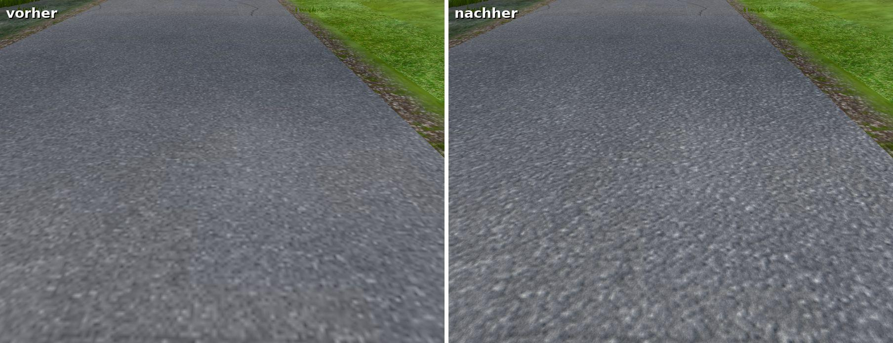
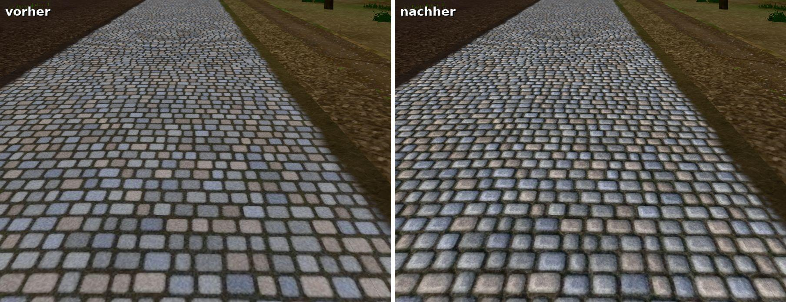
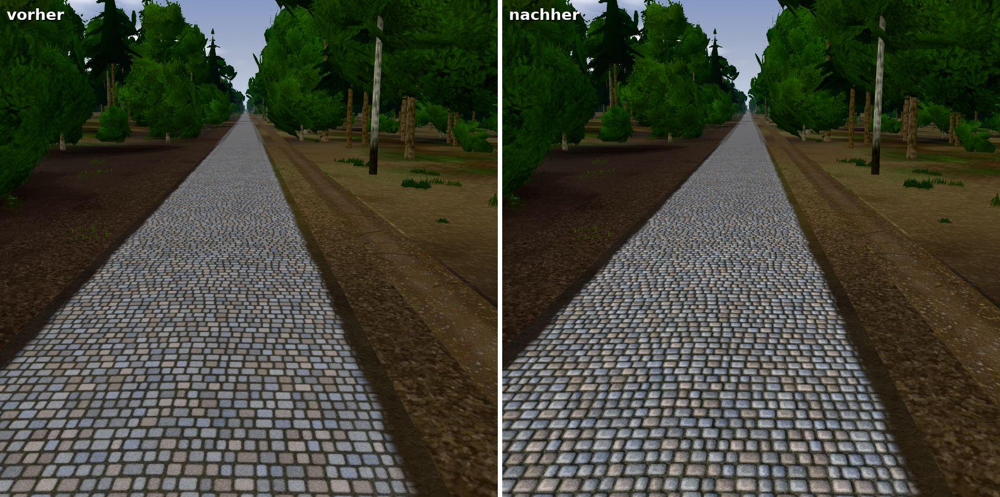
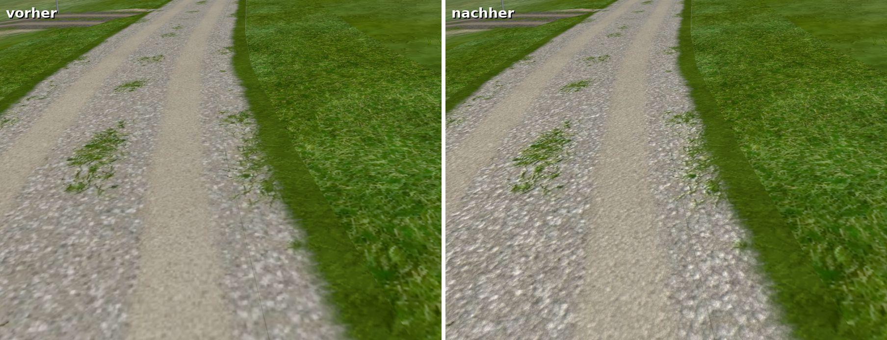
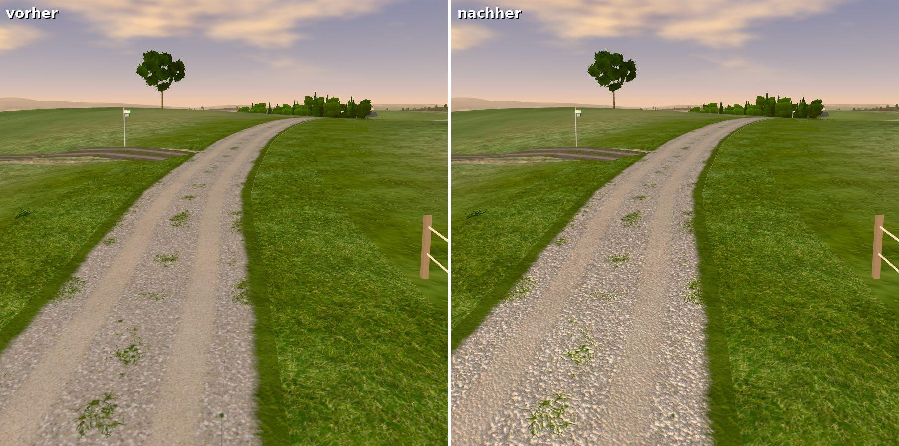
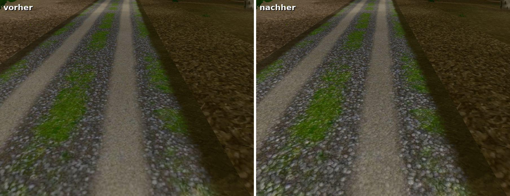
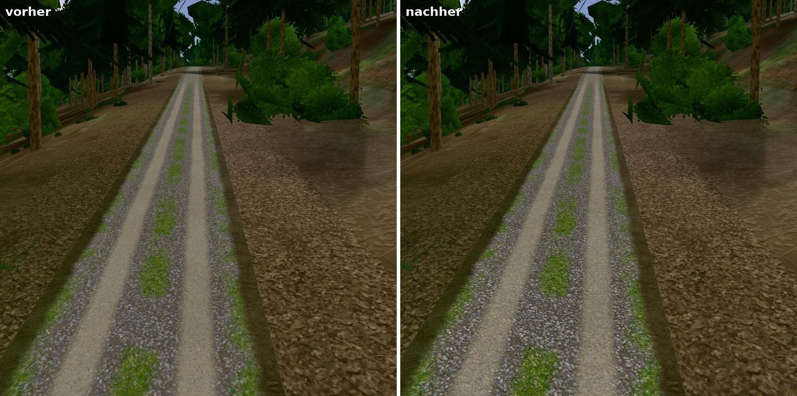

# Nahdetail der Fahrbahn

Was der Fahrer die ganze Zeit sieht, ist die Fahrbahn 1–30 m vor dem Rad. Bis hierher bestand sie
nur aus Farbe: Belagstextur (`RouteTextures`, rund 1 cm je Pixel) mal Vertexfarbe, flache Normale,
eine Rauheit für alles — aus der Nähe ein Foto auf dem Boden. Das Nahdetail gibt den Belägen
**Oberfläche**, ohne Streckenformat oder Streckenbau zu ändern: alles steckt im Material
(`surface.mat`/`surface_blend.mat`) und in kleinen, selbst erzeugten Detailkarten.

## Bausteine

| | was | wo |
|---|---|---|
| Detailkarten | je Belagsgruppe eine kachelbare Karte, RGB: Gefälle dH/dx, dH/dz in R/G, Höhe/Hohlraum in B | `app/src/main/assets/indoor/surface-detail/*.jpg` |
| Parameter je Belag | Karte, Meter je Wiederholung, Stärken, Rauheit, Fahrspuren | `…/surface-detail/detail.json` |
| Generator | zeichnet Karten und `detail.json`, reproduzierbar (feste Startwerte, FFT-Rauschen, periodische Voronoi-Zellen) | `tool/indoor-dev/filament/nahdetail.py` |
| Material | Vorlage für beide Belags-Materialien | `tool/indoor-dev/filament/surface-mats.py` → `app/src/main/materials/surface*.mat` → `materials.sh` |
| App | Regeln und `detail.json` (getestet), Karten laden, Parameter setzen | `SurfaceNearDetail.kt`, `SurfaceNearTextures.kt`, zwei Aufrufe in `WorldMaterialProvider` |
| Referenzrenderer | lädt Karten und Parameter genauso (stb_image) | `filarender.cpp` (`nearKey`, `setupNear`) |
| Bilder | Vorher/Nachher, 4 Strecken, Lenker und Verfolger | `tool/indoor-dev/filament/nahdetail-bilder.sh`, `docs/indoor/bilder/nahdetail/` |

Karten (Belag → Karte): Asphalt → `asphalt` (0,75 m je Karte, Splitt 3–8 mm, Poren), Beton und
Holz → `concrete` (feine Körnung, Luftporen), Verbund- und Kopfsteinpflaster → `stone`
(Bruchfläche des Steins), wassergebundene Decke und Schotter → `gravel` (gerundete Steine
1–4 cm, Sand, Lücken; 0,7 bzw. 1,2 m je Karte), Erde → `dirt` (Krümel, Steinchen, Nadeln,
Zweige), Wiesenweg → `grass` (Halme), Sand → `sand` (Körnung, flache Riffel). Gezeichnet wird
in 512²; Asphalt und Schotter bleiben 512² (die häufigsten Beläge), die übrigen werden auf 256²
gemittelt (Maßstab bleibt). JPEG 4:4:4 (keine Farbunterabtastung — R/G sind Richtungen), Q 85.

## Im Material

Nur auf Fahrbahnen (`mat_route_<belag>`, `x_mat_road_<belag>`; nicht Bordstein, Insel,
Randstreifen — die haben ihr eigenes Boden-Detail). `nearA.x` = 0 schaltet alles ab; das
Material rechnet dann genau wie vorher.

1. **Detail in Weltkoordinaten** (`getUserWorldPosition().xz`, wie das Boden-Detail; nichts
   verzerrt in Kurven, keine Nähte an Bandstücken) in **zwei Maßstäben**: der zweite Zugriff ist
   um 37° gedreht und 2,63-mal größer — die Wiederholung der Karte ist so nicht zu sehen. Ergibt
   Detail-Normale (Mikroschatten), Helligkeit aus der Höhe (Poren dunkel) und Rauheit (Kornspitzen
   glatter, Poren rauer). Weich aus zwischen 17,6 und 32 m (`rangeM`).
2. **Relief aus dem Belagsbild**: Fugen, Risse, Flicken und Steine stehen schon in der
   Belagstextur — ihr Helligkeitsgefälle (dunkel = tief, relativ zur örtlichen Helligkeit) wird
   zur Normale. Die Richtung von u und v in der Welt kommt aus den Bildschirmableitungen von Lage
   und UV (Kotangenten-Rahmen, ohne Tangenten im Netz; die Ableitungen stehen vor jeder
   Verzweigung). Zentrale Differenzen über `reliefTexels` und eine Mindest-Mip-Stufe
   `reliefMip`, damit nur Fugen und Steinkanten wirken, nicht die Sprenkel im Stein (sonst
   kippt die ganze Steinfläche). Das macht aus dem Kopfsteinpflaster gewölbte Steine mit
   vertieften Fugen. Weich aus bis 40 m (`reliefRangeM`). `textureLod` mit expliziter Stufe —
   auch in ungleichförmigen Verzweigungen definiert.
3. **Rauheit je Belag**: Asphalt 0,90 (matt), Pflaster 0,80, Kopfstein 0,74 (polierte Köpfe),
   Schotter/Erde 0,95–0,96; auf Zweispur-Wegen sind die **Fahrspuren** glatter und feiner
   (Lage aus der Belags-UV, `RouteTextures.TRACK_OFFSET_M` / Texturbreite = 0,242).
4. **Energieausgleich**: gekippte Normalen dunkeln im Mittel ab (cos des Kippwinkels); das wird
   auf Fahrbahnen ausgeglichen, sonst entstünde beim Ausblenden ein Helligkeitsverlauf.

## Sicherheit (Issue 106)

- Beide Belags-Materialien deklarieren weiter alle Parameter, die gltfio setzt
  (`baseColorFactor`, `emissiveFactor`, `metallicFactor`, `roughnessFactor`, `normalScale`,
  `aoStrength`, `baseColorMap`), dazu `nearMap`, `nearA`, `nearB`, `nearC`. Test
  `SurfaceNearDetailTest` prüft die Quellen.
- Die App setzt `nearMap`/`nearA…C` nur, wenn `Material.hasParameter` sie bestätigt (ältere
  `.filamat` ohne Nahdetail laufen weiter). `nearMap` ist auf jeder Belags-Instanz gebunden
  (Karte oder neutrale 1×1-Textur), auch auf Randstreifen.
- Fehlt `detail.json` oder eine Karte, oder lässt sie sich nicht lesen: Nahdetail für diesen
  Belag aus, kein Abbruch. Schlägt das Anlegen der neutralen Textur fehl, fällt das Material wie
  bisher auf den Ubershader zurück.
- **Sicherer Modus** (`RenderGuard`): die Karten werden nicht geladen, die Belags-Materialien
  nicht benutzt (Ubershader) — wie bisher.
- **Schalter**: hängt an `groundDetail` („Bodendetails“; LOW und SAFE aus, MEDIUM/HIGH an),
  sofort auf allen lebenden Instanzen. Aus = Fahrbahn exakt wie vor dem Nahdetail (im
  Referenzrenderer verglichen: Fahrbahn pixelgleich).

## Kosten (geschätzt; nicht auf dem Gerät gemessen)

| | vorher | nachher |
|---|---|---|
| Paket (APK) | — | +0,99 MB Karten (2 × 0,31 MB, 5 × 0,07–0,08 MB), +0,04 MB `.filamat` |
| Arbeitsspeicher (Java) | — | 0,99 MB JPEG-Bytes, solange die Darstellung lebt |
| Grafikspeicher | — | je **geladener** Karte 1,4 MB (512², RGBA8 mit Mip-Stufen) bzw. 0,35 MB (256²); geladen wird erst, wenn ein Belag die Karte braucht. Typisch Asphalt + Schotter: 2,8 MB; alle sieben: 4,5 MB |
| Texturzugriffe je Fahrbahn-Pixel | bis 45 m: 5 (Anisotropie), dahinter 1 | bis 32 m: +2 (Detail), bis 40 m: +4 (Relief, `textureLod`); dahinter unverändert |
| Rechenaufwand | — | dazu grob geschätzt 60 ALU-Befehle nah (Rahmen, Normale, Ausgleich), 4 Ableitungen immer |
| Shader-Varianten | — | keine neuen (gleiche Materialien, Verzweigung über Parameter) |

## Geprüft

- **Referenzrenderer** (Filament 1.75.1 Desktop, Mesa llvmpipe, OpenGL): alle Bilder unten.
  Vorher = `.filamat` aus `main`, nachher = dieser Stand. Ohne Fahrer (das Modell entsteht in
  einem App-Test, den diese Umgebung nicht bauen konnte), Himmel aus `indoor-dev sky` (Mittag
  62,9° Sonne, Abend 11°).
- **Nicht geprüft**: auf einem Gerät (Samsung Galaxy S25 o. ä.), OpenGL ES/Vulkan-Treiber,
  Bildrate, Speicher; three.js-Betrachter (kennt die eigenen Materialien nicht).
- **Bau**: in dieser Umgebung kein Gradle-Bau möglich (Maven Central 429, kein Android-SDK) —
  `SurfaceNearDetail` und `SurfaceNearDetailTest` lokal mit dem Kotlin-Compiler übersetzt und
  grün, `SurfaceNearTextures` und die Änderungen am Provider **ungebaut**.

## Bilder

Je Bild links vorher, rechts nachher (untere 55–75 % des Bildes, 900 × 1200 je Hälfte).

| | |
|---|---|
| Asphalt, Alpe d'Huez km 5, Lenker |  |
| Kopfstein, Arenberg km 6,5, Lenker |  |
| Kopfstein, Verfolger |  |
| Strada Bianca, Monte Sante Marie km 3, Lenker |  |
| Strada Bianca, Abendsonne, Verfolger |  |
| Schotter im Wald, Rennsteig km 1,5, Lenker |  |
| Waldweg, Rennsteig km 7, Verfolger |  |

## Offen

- Weiter mit echten Texturen: [pbr-texturen.md](pbr-texturen.md) (PBR-Sätze für Fahrbahn,
  Randstreifen und Gelände; nimmt das Nahdetail im Nahbereich zurück).

- Gegenlicht und Streiflicht wirken am stärksten; mit der Sonne im Rücken (Kopfstein am Abend)
  ist der Gewinn klein — wie in echt, aber dort hilft das Relief wenig.
- Der Belagswechsel (`x_mat_route_<belag>_fade`, Maske, Ubershader) und Straßenkanten
  (`x_mat_road_*_edge`) haben kein Nahdetail — auf ~6 m an Wechseln flacher.
- Holz (Brücken) nutzt die Betonkarte isotrop; Maserung längs der Bretter bräuchte die
  Brettrichtung (UV), nicht Weltkoordinaten.
- Nässe/Pfützen, Laub auf der Fahrbahn, Reifenspuren im Asphalt: nicht umgesetzt.
- Asphalt-Fahrspuren (polierte Rollspur) bräuchten die Fahrstreifenlage; die Textur kennt sie nicht.
