# PBR-Texturen für Fahrbahn, Randstreifen und Gelände

Branch `claude/grafik-pbr-texturen` (Start: `claude/grafik-nahdetail`). Ziel: ein deutlicher
Schritt Richtung Fotorealismus aus der Nähe — echte, fotografierte Oberflächen (Farbdetail,
Normale, Rauheit) statt Farbe plus prozeduraler Körnung. Streckenformat und Streckenbau sind
unverändert (`WORLD_BUILDER_ID` nicht angehoben); alles steckt in Materialien und App-Assets.

**Alles unten ist im Filament-Referenzrenderer gesehen (Filament 1.75.1, lavapipe-Vulkan mit
PCF-Schatten), nicht auf einem Gerät.** App-Code ist **UNGEBAUT** (kein Gradle in dieser
Umgebung); die reinen Regeln und ihr Test sind lokal mit dem Kotlin-Compiler übersetzt und grün.

## Bestandsaufnahme (vorher)

| Fläche | Texturinformation | Kamera | Eindruck |
|---|---|---|---|
| Fahrbahn je Belag (`mat_route_<b>`, `x_mat_road_<b>`) | Belagsbild aus dem Streckenbau (256 × 1024, ≈ 1 cm/px, 8–16 m Wiederholung, Vertexfarben) + Nahdetail (prozedurale Karte, Normale/Helligkeit/Rauheit bis 32 m) + Relief aus dem Belagsbild bis 40 m + Software-Anisotropie bis 45 m | ab ≈ 2 m vor dem Rad (Lenker: Auge 1,46 m); füllt das untere Drittel bis Hälfte des Bildes | Kopfstein als sauberes Raster gleicher Steine („Plastikfliesen“); Schotter und Erde als Rauschen in drei regelmäßigen Bändern; Asphalt körnig ohne Splitt |
| Randstreifen (`x_mat_route_verge_*`, Bankett, Gehweg, Graskante, Ausläufe) | Streckenbau-Textur + `GroundDetail` (selbst gezeichnete 256²-Höhe, 4 Bodenarten, Helligkeit und Normale bis 35 m) | 1–10 m | Wiese als flacher grüner Teppich, Waldboden flächig braun |
| Gelände (`mat_terrain`) | Luftbild (≈ 1 m/px) + `GroundDetail` bis 55 m, Bodenart aus der Luftbildfarbe, Fleckung 32 m | erst ab ≈ 5–10 m, meist 10–55 m | an Hängen verschmiertes, oft blaugrünes Luftbild — dort hilft eine Detailtextur nur begrenzt |
| Felder/Wald/Fels/Wiese | dieselbe `GroundDetail`-Karte, andere Kanäle | | |

## Was neu ist

| | was | wo |
|---|---|---|
| Texturen | 12 CC0-Sätze von ambientCG in 6 Textur-Arrays, je Array `<gruppe>_c.ktx` (ETC2_EAC_SRGB8_ALPHA8: Farbdetail RGB + Rauheit A) und `<gruppe>_n.ktx` (EAC_RG11: Normale X/Y), volle Mip-Ketten | `app/src/main/assets/indoor/pbr/` |
| Parameter | Gruppen, Schichten, Maßstab und Stärken je Belag/Randstreifen, Gelände | `…/pbr/pbr.json` |
| Lizenz | Herkunft je Satz, CC0 geprüft | `…/pbr/LICENSES.md` |
| Generator | lädt (`fetch`), verkleinert, normiert, packt, komprimiert (`build`); reproduzierbar | `tool/indoor-dev/filament/pbr.py` (numpy, pillow, etcpak) |
| Material | Fahrbahn/Randstreifen (Vorlage) und Gelände | `surface-mats.py` → `surface.mat`/`surface_blend.mat`, `terrain.mat` |
| App | Regeln + `pbr.json` + KTX-Kopf (getestet), Laden/Binden, Schalter | `PbrRules.kt`, `PbrTextures.kt`, `PbrRulesTest.kt`; je zwei Zeilen in `WorldMaterialProvider`/`FilamentWorldRenderer` |
| Referenzrenderer | lädt die Arrays genauso (`pbrKey`, `setupPbr`), prüft das Format | `filarender.cpp` |

### Sätze und Gruppen

| Gruppe | Größe | Schichten (ambientCG) | genutzt von |
|---|---|---|---|
| `asphalt` | 1024² | Asphalt031 (neu), Road013A (alt, Risse/Flicken) | Asphalt |
| `cobble` | 1024² | PavingStones070 | Kopfsteinpflaster |
| `concrete` | 512² | Concrete048 | Beton, Verbundpflaster, Gehweg, Holz (nur fein) |
| `gravel` | 1024² | Gravel022, Ground091 | Schotter, wassergebundene Decke (gegenseitig als Makrovariation) |
| `earth` | 512² | Ground106, Ground080 | Erde/Waldweg, Sand |
| `terrain` | 512² | Grass004, Ground103, Ground082S, Rock030 | Gelände (Wiese, Acker, Waldboden, Fels), Wiesenweg, Randstreifen, Graskante, Bankett |

Maßstab: wo ambientCG eine Kantenlänge nennt, diese; sonst nach Korngröße geschätzt (in
`pbr.py`, Tabelle `SETS`). Kopfstein auf 1,5 m gestreckt (Steine ≈ 12–14 cm wie Großpflaster).

### Aufbereitung (`pbr.py build`)

- Quelle: 1K-JPG (Farbe, NormalGL, Rauheit, AO, Höhe nur zur Prüfung).
- **Farbe wird Detail:** linear, mit √AO verrechnet, grobe Helligkeitsverläufe der Kachel
  herausgenommen (Gauß über ⅛ der Kachel, Exponent 0,8; Gelände 0,5, damit Büschel/Schollen
  bleiben — sonst sieht man die Wiederholung), je Kanal auf Mittel 1, Farbschwankung auf 45 %
  gedämpft. Gespeichert als Faktor/2 in sRGB. Die **Farbe der Strecke bleibt** die des
  Belagsbilds bzw. Luftbilds.
- **Normale:** NormalGL, Y gedreht (unsere Konvention: Y zeigt nach +t). Gegenprobe gegen das
  Höhenbild je Satz (Korrelation 0,57–0,98, sonst Abbruch).
- **Mip-Ketten** selbst gerechnet: Farbe linear gemittelt, Normale gemittelt und normiert,
  Rauheit nach Toksvig erhöht (kein Glitzern in der Ferne).
- **Kanalpackung:** Farbe + Rauheit in einer ETC2-RGBA-Textur (1 Byte/Texel), Normale X/Y in
  EAC RG11 (1 Byte/Texel, gute Qualität für Normalen). Höhe wird nicht mitgeliefert (kein
  Parallax auf dem Handy), AO steckt in der Farbe.

### Im Material

**Fahrbahn und Randstreifen** (`surface.mat`/`surface_blend.mat`, auch die Ausläufe
`x_mat_route_<b>_fade`): bis `rangeM` = 30 m, weich aus ab 15 m.

1. Koordinaten in **Weltlage** (keine Nähte an Bandstücken, nichts verzerrt) in **zwei
   Maßstäben** (zweiter um 37° gedreht, 2,63-mal größer, 40 % Gewicht); **Kopfstein in
   Fahrbahn-UV** (u × 2 m, v × 8 m), damit die Steinreihen der Straße folgen.
2. **Makrovariation:** Wertrauschen in Weltlage (≈ 9 m und 3,7 m) blendet in Flecken die
   zweite Schicht ein (Asphalt: 55 % der Fläche alter, rissiger Belag; Schotter ↔ Splitt;
   Wiese mit erdigen Stellen; Bankett Erde ↔ Fels).
3. **Farbe:** `pbrA.w` steuert, wie viel Feinstruktur des Belagsbilds ersetzt wird — 0: Detail
   × Belagsbild; 1: grobe Mip-Stufe des Belagsbilds (`keepLod`) × Detail. Asphalt 0,5 bei
   Stufe 2 (Flicken/Risse des Belagsbilds bleiben), Schotter 0,65, Kopfstein 1,0 bei Stufe 5
   (echte Steine statt des gezeichneten Rasters, Farbton der Strecke bleibt).
4. **Normale** aus der Textur (+ zweiter Maßstab), **Rauheit** aus der Textur
   (`pbrC`: Skala, Versatz, Anteil) — Kopfsteinköpfe und Asphaltsplitt glänzen, Fugen und
   Sand sind matt. Das Spiegelungs-Umgebungslicht von `indoor-renderqualitaet` nutzt genau diese
   Rauheit und Normale (Bilder `hoch-*`).
5. In den **Fahrspuren** der Zweispur-Wege (verdichtet) 60 % weniger Korn und Relief.
6. Nah ersetzt PBR das Boden-Detail der Randstreifen; Nahdetail-Körnung und Relief aus dem
   Belagsbild werden im PBR-Bereich zurückgenommen (bei Kopfstein ganz), dahinter wie vorher.
   Energieausgleich der gekippten Normalen wie beim Nahdetail. Alle Zugriffe mit `textureGrad`
   und Ableitungen von vor jeder Verzweigung.

**Gelände** (`terrain.mat`): bis 55 m (weich aus ab 30 m), ersetzt dort das `GroundDetail`.
Die zwei stärksten Bodenarten des Pixels (aus der Luftbildfarbe wie bisher), die stärkste in zwei
Maßstäben (zweiter gespiegelt, ⅓ der Wiederholung); je Bodenart eine andere 90°-Drehung.
Wiederholungen je 256-m-Kachel ganzzahlig (nahtlos über Kachelgrenzen). Farbe weiter aus dem
Luftbild (Detail 70 %), Fleckung aus dem Wolkenrauschen bleibt.

### Schalter und Grafikstufe

- Auf diesem Branch hängt PBR an **„Bodendetails“** (`RenderSettings.groundDetail`; LOW und
  SAFE aus, MEDIUM/HIGH an) — sofort auf allen lebenden Instanzen (`WorldMaterialProvider.apply`,
  neuer Parameter `pbr`).
- **Nach dem Zusammenführen mit `indoor-renderqualitaet`** eine Zeile in
  `FilamentWorldRenderer.applySettings`: `pbr = settings.groundDetail && settings.reflections`
  — dann **Standard unverändert**, Hoch/Ultra mit PBR (beide setzen `reflections`). Steht als
  Kommentar an der Stelle.
- `pbrA.x` = 0 → das Material rechnet wie vorher. Im Referenzrenderer verglichen: neue
  Materialien mit PBR aus gegen den Stand vorher — Belagsflächen pixelgleich, Abweichung
  (0,1–0,3 von 255) nur an Schattenkanten und Laub, so groß wie zwischen zwei gleichen Läufen
  (0,39).

### Sicherheit (Issue 106, native Abbrüche)

- Alle drei Materialien deklarieren weiter alle Parameter, die gltfio setzt, dazu `pbrMapC`,
  `pbrMapN` (`sampler2dArray`), `pbrA…C` (Gelände) bzw. `pbrA…D`. Test `PbrRulesTest` prüft die
  Quellen.
- Die App setzt sie nur, wenn `Material.hasParameter` sie bestätigt (ältere `.filamat` laufen
  weiter). `pbrMapC`/`pbrMapN` sind auf jeder Instanz gebunden (Gruppe oder neutrale
  1×1-Array-Textur).
- **Format vorher prüfen:** `Texture.isTextureFormatSupported(ETC2_EAC_SRGBA8, EAC_RG11)`.
  Gefunden im Referenzrenderer: **lavapipe-Vulkan kann kein ETC2, und Filament bricht dann beim
  Anlegen der Textur nativ ab** („Texture format 64 not supported“). Auf Android-GLES 3.x ist
  ETC2 Pflicht; unter Vulkan können einzelne Treiber es nicht — dann bleibt PBR aus.
- KTX-Kopf und jede Mip-Größe werden geprüft (`PbrRules.readKtx`), Dateinamen aus `pbr.json`
  nur ohne Pfad. Fehlt/scheitert etwas: diese Gruppe aus, kein Abbruch.
- **Sicherer Modus:** `pbr.json` wird nicht geladen, die eigenen Materialien nicht benutzt
  (Ubershader) — keine neuen Effekte.
- Größe beim Hochladen = Bytes **aller Schichten** einer Mip-Stufe (`glCompressedTexSubImage3D`
  in Filaments `OpenGLDriver.cpp`); im Referenzrenderer mit OpenGL (llvmpipe kann ETC2) gegen die
  entpackte Kopie verglichen: mittlere Abweichung 0,17 von 255.

## Kosten

| | Wert | gemessen / geschätzt |
|---|---|---|
| App-Größe | +18,88 MB Texturen (unkomprimiert; im ZIP 18,0 MB, `zip -9`), +0,11 MB `.filamat`, +10 kB `pbr.json`/Lizenz | gemessen (Dateien); APK nicht gebaut |
| Grafikspeicher je **geladener** Gruppe | asphalt 5,6 MB · gravel 5,6 · cobble 2,8 · terrain 2,8 · earth 1,4 · concrete 0,7 | berechnet (komprimiert = Dateigröße) |
| typisch je Strecke | Asphaltstrecke mit Wiesen/Wald (Alpe d'Huez): asphalt + terrain ≈ **8,4 MB**; gemischt (Rennsteig: Asphalt, Schotter, Erde, Gehweg): ≈ **16 MB**; alles: 18,9 MB | berechnet |
| Arbeitsspeicher (Java) | `pbr.json` 8 kB dauerhaft; je Gruppe die KTX-Bytes kurz beim Laden (bis 3,7 MB) | berechnet |
| Texturzugriffe je Pixel, Fahrbahn bis 30 m | +5 (2 Maßstäbe × Farbe/Normale, grobe Belagsfarbe), +2 in Flecken der zweiten Schicht; Kopfstein +3 | gezählt |
| Gelände bis 55 m | 3 Zugriffe `GroundDetail` → 4–6 (2 Maßstäbe der stärksten Art, zweite Art bei Mischung) | gezählt |
| Rechenaufwand | grob +50 Befehle je Pixel nah (Rahmen, Rauschen, Mischung) | geschätzt |
| Bildzeit | **Schätzung** S25-Klasse, 1080 × 2340: +0,3–0,8 ms GPU (Fahrbahn ≈ ⅓ des Bildes, komprimierte Texturen sind cachefreundlich); auf dem Gerät mit der Bildratenmessung von `indoor-renderqualitaet` prüfen | geschätzt |
| Shader-Varianten | keine neuen (Verzweigung über Parameter) | |
| Laden | je Gruppe einmal beim ersten Belag, der sie braucht (Hauptthread wie die Materialien): bis 3,7 MB lesen + hochladen, keine Dekodierung | nicht gemessen |

## Bilder (`docs/indoor/bilder/pbr/`)

Gleiche Kamera, gleicher Himmel (`indoor-dev sky`, 48,8° N; Mittag 62,9°, Abend 11°), ohne Fahrer,
Hochformat 900 × 1200, oberer Teil abgeschnitten. **Vorher** = Materialien von
`claude/grafik-nahdetail` (Nahdetail an), **nachher** = dieser Stand. Gerechnet mit
lavapipe-Vulkan (PCF-Schatten); weil lavapipe kein ETC2 kann, liest der Referenzrenderer dort
eine entpackte Kopie derselben Blöcke (`pbr.py decode`, `FILARENDER_PBR_DIR`). Die Bilder
`hoch-*` sind aus einem lokalen Probe-Merge mit `claude/indoor-renderqualitaet` (Stufe Hoch:
Spiegelungs-IBL, SSAO, Bloom, Weißabgleich), links PBR aus, rechts an — nicht gepusht.

| Bild | Strecke | Was man sieht |
|---|---|---|
| 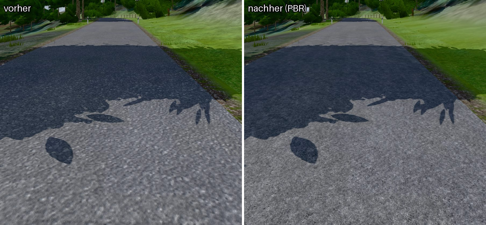 | Alpe d'Huez km 5, Mittag, Lenker | feiner Splitt statt Rauschen, Flecken älteren Belags; insgesamt ruhiger, im Schatten weniger Relief als das alte Nahdetail |
| 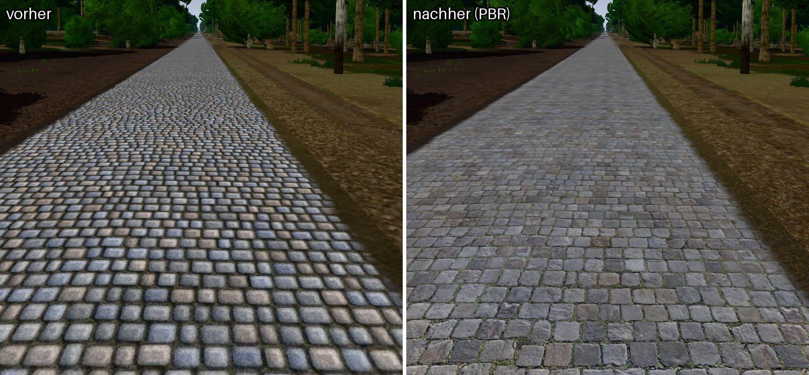 | Arenberg km 6,5, Mittag, Lenker | **größter Gewinn**: unregelmäßige Granitsteine mit Moos in den Fugen statt des gezeichneten Rasters |
| 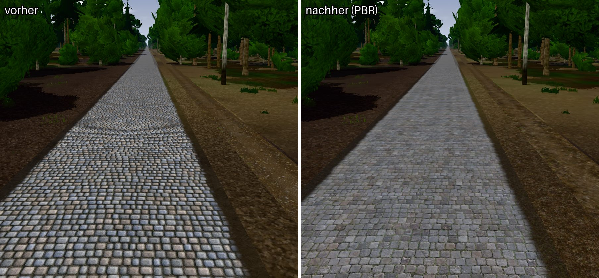 | Arenberg, Verfolger | nah echt, **in 10–30 m weicher und flacher als vorher** (dort hatte das alte Belagsbild Software-Anisotropie; lavapipe filtert die PBR-Textur vermutlich ohne Anisotropie — auf dem Gerät prüfen) |
| 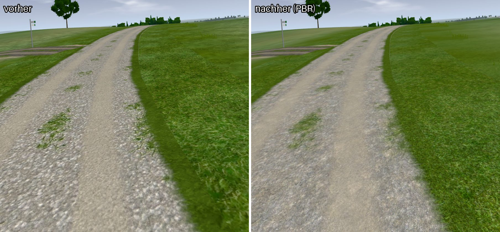 | Monte Sante Marie km 3, Mittag | staubiger, verdichteter Splitt; Graskante unverändert grün |
| 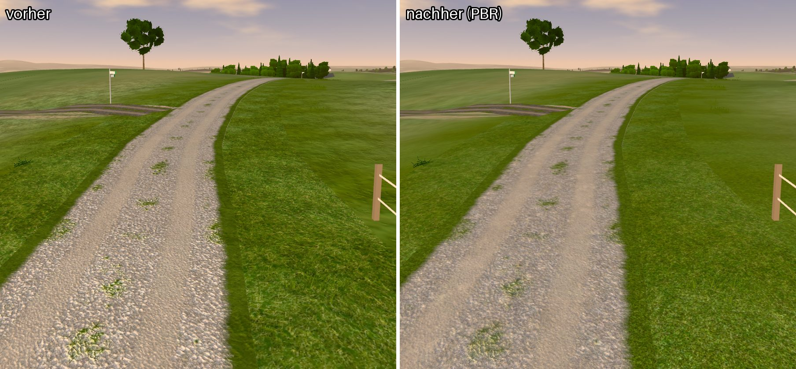 | dasselbe, Abend | bei Streiflicht wirkt das alte prozedurale Relief kräftiger; PBR weicher, natürlicher in der Farbe |
| 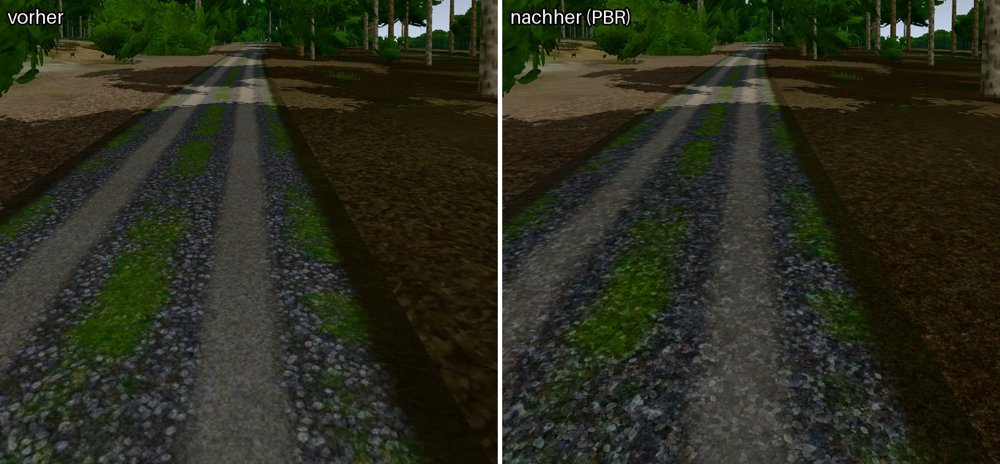 | Rennsteig km 1,5, Lenker | echte Kiesel statt Rauschen, Fahrspuren bleiben sichtbar, Waldboden-Rand mit Nadelstreu |
| 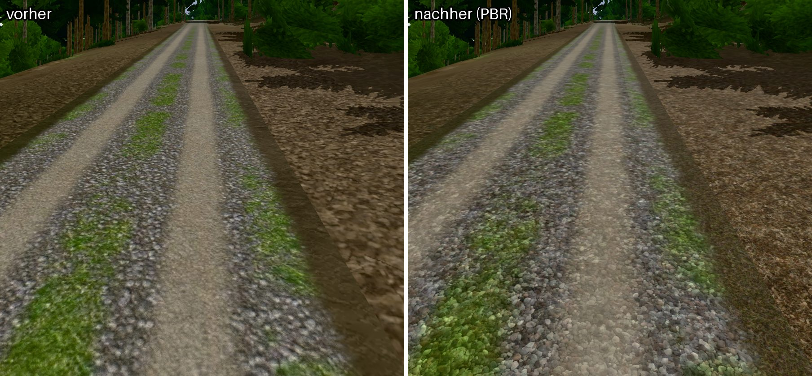 / 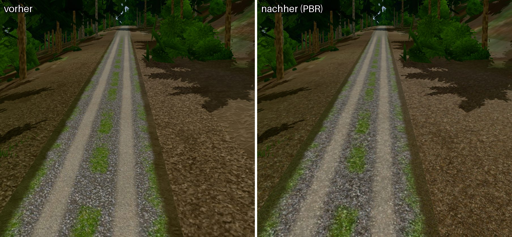 | Rennsteig km 7 | Kiesel und Moos, Bankett/Waldrand mit Streu; Bänder weniger regelmäßig |
| 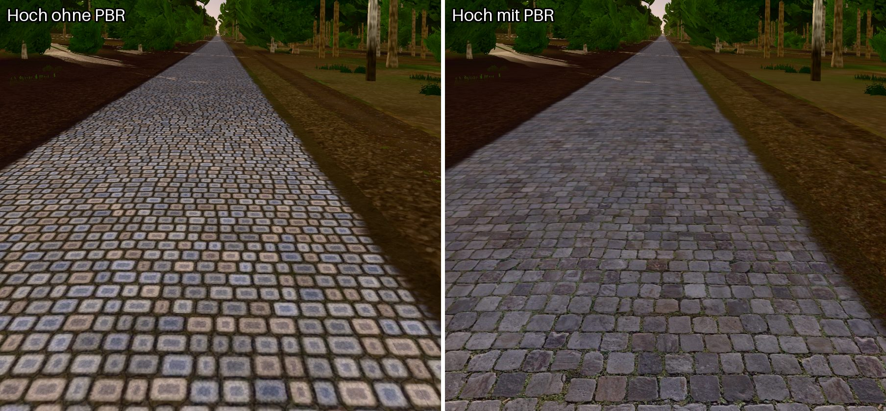 | Arenberg, Abend, Stufe Hoch | Steine mit Glanzkanten und Fugenschatten; abends rund 15 % dunkler (tiefe Sonne auf gewölbten Steinen) |
| 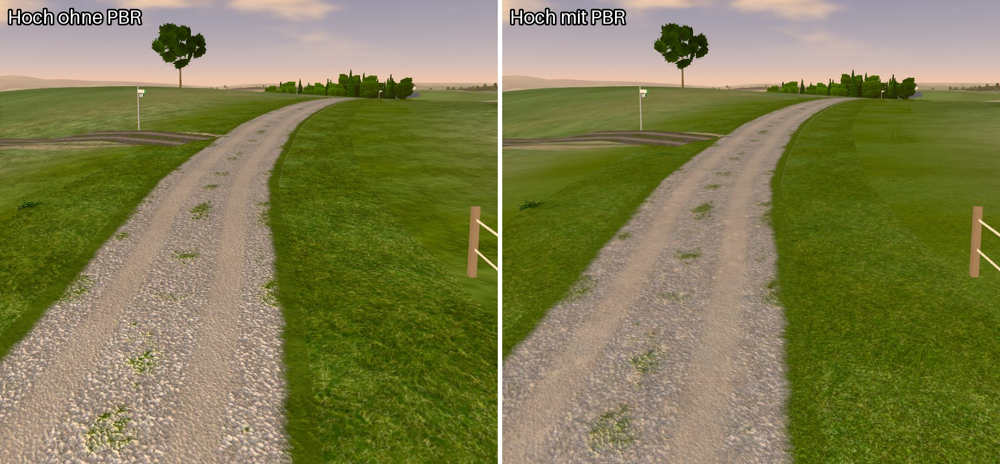 | Monte Sante Marie, Abend, Hoch | dezent; Weg weicher |
| 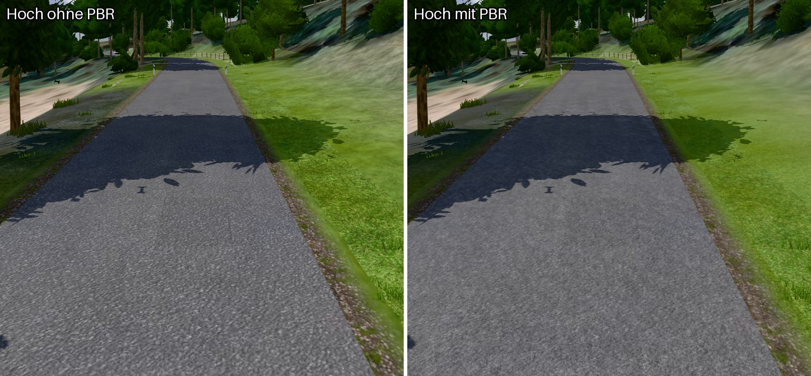 | Alpe d'Huez, Mittag, Hoch | Asphalt feiner, Himmelsglanz kaum sichtbar (Asphalt bleibt rau) |

Ehrlich: Der Sprung ist **nah** (0–10 m) deutlich — Steine, Kiesel, Splitt sehen fotografiert
aus. In **10–30 m** ist der Gewinn klein, teils wirkt es flacher als das prozedurale Relief.
Wiesen und Gelände ändern sich kaum sichtbar (Halme liegen ab 10 m unter einem Pixel; die Farbe
kommt aus dem Luftbild, und das bleibt an Hängen verschmiert). Fotorealismus entsteht damit noch
nicht; die größten weiteren Hebel sind Bäume und ein feineres Luftbild nahe der Strecke
(`render.md`, Abschnitt Renderqualität).

## Auf dem Gerät zu prüfen

- [ ] Logcat ohne `PbrTextures`-Warnungen; bei „ETC2/EAC nicht unterstützt“ melden (Gerät,
      Backend). Kein Absturz beim Laden einer Strecke mit Kopfstein/Schotter/Asphalt.
- [ ] Kopfstein (Arenberg), Schotter/Waldweg (Rennsteig), Asphalt (Alpe d'Huez), Strada Bianca:
      nah echte Steine/Kiesel; **in 10–30 m scharf oder matschig?** (Hardware-Anisotropie 8×).
- [ ] Kein sichtbarer Ring beim Ausblenden (15–30 m Fahrbahn, 30–55 m Gelände), keine
      Kachelwiederholung, keine Nähte an Kachelgrenzen des Geländes.
- [ ] Kein Flimmern/Glitzern bei Fahrt (Normalen und Rauheit in der Ferne).
- [ ] Kopfstein: Steinreihen folgen der Straße auch in Kurven; abends nicht zu dunkel.
- [ ] „Bodendetails“ aus → Fahrbahn wie vorher (sofort, ohne Neuladen).
- [ ] Bildrate (nach dem Merge: Diagnose → „Bildrate je Stufe“), Hoch mit/ohne PBR; Speicher
      (`WorldMaterialProvider.pbrGpuBytes`).
- [ ] App-Größe des Release-APK (erwartet ≈ +18 MB).

## Offen

- Mittlere Entfernung (10–30 m): eigene Software-Anisotropie auch für die PBR-Textur oder
  späteres Ausblenden, falls das Gerät matschig zeigt.
- Kopfstein wiederholt sich alle 1,5 m (eine Kachel, keine zweite Schicht in UV) — bei genauem
  Hinsehen erkennbar; eine zweite Pflaster-Schicht kostet 2,8 MB.
- Belagswechsel (Maske) und Straßenkanten (`x_mat_road_*_edge`, Ubershader) ohne PBR.
- Holz: nur Betonkörnung; Bretter bräuchten einen eigenen Satz und die Brettrichtung.
- Höhe/Parallax, Nässe, Laub auf der Fahrbahn: nicht umgesetzt.
- Maßstäbe einiger Sätze geschätzt (ambientCG nennt sie nicht).
- Die drei Textur-Arrays mit 1024² (asphalt, gravel, cobble) könnten auf 768² oder ASTC
  (bessere Qualität je Byte, auf Geräten mit ASTC) — erst nach Gerätebefund.
- Diagnoseseite zeigt die geladenen Gruppen noch nicht (Werte stehen in `WorldMaterialProvider`).

## Software-Anisotropie des Luftbilds (`terrain.mat`, Zusatzauftrag)

Hinweis aus der Luftbild-Sitzung (`claude/grafik-luftbild-20cm`, `terrain_band.mat`): flach
gesehen tastet `terrain.mat` das Luftbild einmal ab, die Hardware wählt ab ≈ 20 m eine
Mip-Stufe mit ≈ 1 m je Texel (gltfio setzt keine Anisotropie). Übernommen wie dort und in
`surface.mat`: bis `anisoRange` = 90 m (weich aus ab 63 m) vier `textureLod`-Abtastungen entlang
der langen Achse der Pixelspur, sobald sie mehr als 1,6 : 1 gestreckt ist.

- Parameter `anisoRange` deklariert, gesetzt nur nach `Material.hasParameter`; 0 = ein Zugriff
  wie vorher. Hängt am selben Schalter wie PBR (`WorldMaterialProvider.pbr`: „Bodendetails“,
  nach dem Merge Hoch/Ultra); sicherer Modus: eigene Materialien aus.
  Referenzrenderer: `settings.terrainAniso`.
- **Kosten:** +4 Texturzugriffe je Geländepixel bis 90 m (bei gestreckter Spur; sonst +0),
  ≈ 15 ALU-Befehle. Gelände füllt aus Lenkersicht meist 10–30 % des Bildes. Bildzeit nicht gemessen
  (Schätzung ≤ 0,3 ms auf S25-Klasse).
- **Wirkung im Referenzrenderer: kaum messbar** (mittlere Abweichung 0,02–0,15 von 255, so groß
  wie das Rauschen zwischen zwei Läufen; Bild `gelaende-aniso-lenker.jpg`). Ein Testshader zeigt,
  dass der Zweig auf dem Gelände hinter den Randstreifen (ab ≈ 25 m) läuft — aber das 1-m-Luftbild
  der Katalogstrecken hat dort kaum Feinstruktur, die ein schärferer Mip-Level zeigen könnte.
  Lohnen dürfte es mit dem 20-cm-Band der Luftbild-Sitzung (feinere Textur) und auf Hängen;
  auf dem Gerät prüfen. Ob lavapipe selbst anisotrop filtert, habe ich nicht geprüft.

### Wo die Wirkung aus Lenkersicht sitzt (Ausläufe der Randstreifen)

Die ersten 2–6,5 m neben der Fahrbahn sind die Randstreifen und ihre Ausläufe
(`x_mat_route_verge_*`, `x_mat_route_*_fade`, Graskante `x_mat_route_fringe`), nicht das Gelände.
Die PBR-Texturen sitzen genau dort: Wiesenrand (`verge_grass`, Grass004 + Acker-Flecken),
Waldrand (`verge_forest`, Waldboden Ground082S), Bankett (Erde ↔ Fels), Gehweg (Beton),
Graskante — in `surface.mat` wie in `surface_blend.mat` (Ausläufe), bis 30 m. Sichtbar vor allem
als Nadelstreu am Waldrand (Bilder `schotter-lenker`, `waldweg-*`); auf Wiesen klein, weil
Grashalme schon ab einigen Metern unter einem Pixel liegen.

## Neu erzeugen

```
python3 -m venv /tmp/pbr-venv && /tmp/pbr-venv/bin/pip install numpy pillow etcpak texture2ddecoder
/tmp/pbr-venv/bin/python -I tool/indoor-dev/filament/pbr.py fetch /tmp/pbr-dl        # Downloads: eigenes Verzeichnis
/tmp/pbr-venv/bin/python -I tool/indoor-dev/filament/pbr.py build /tmp/pbr-dl        # → app/src/main/assets/indoor/pbr
python3 tool/indoor-dev/filament/surface-mats.py && tool/indoor-dev/filament/materials.sh
# Referenzrenderer auf lavapipe-Vulkan (kein ETC2): entpackte Kopie
/tmp/pbr-venv/bin/python -I tool/indoor-dev/filament/pbr.py decode app/src/main/assets/indoor/pbr /tmp/pbr-raw
FILARENDER_BACKEND=vulkan FILARENDER_PBR_DIR=/tmp/pbr-raw node tool/indoor-dev/viewer/filashots.mjs …   # --set pbr=0 = vorher
```
